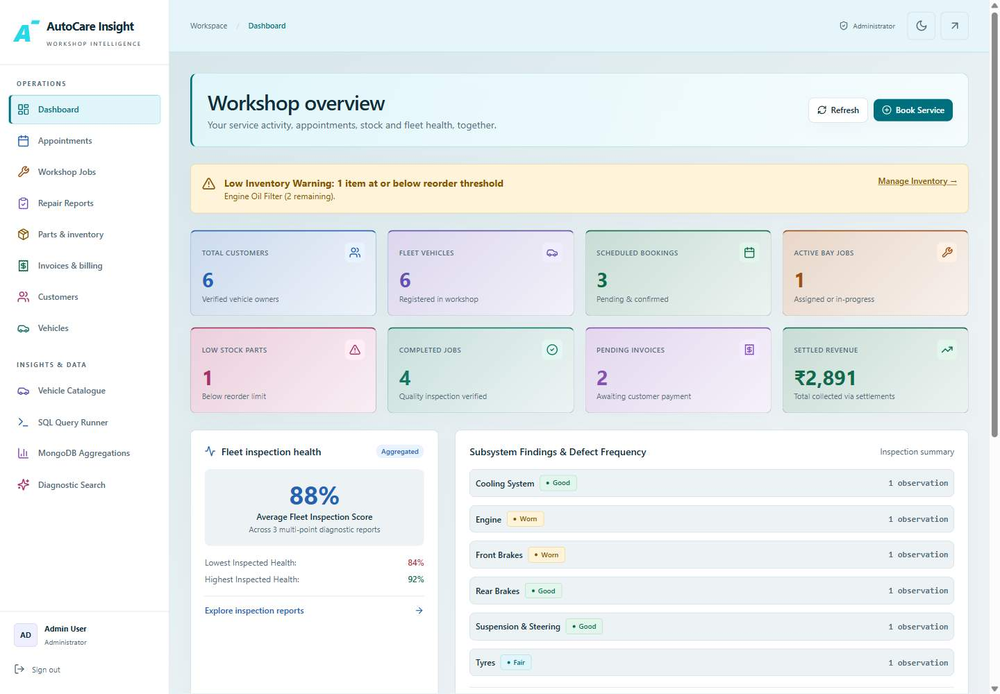
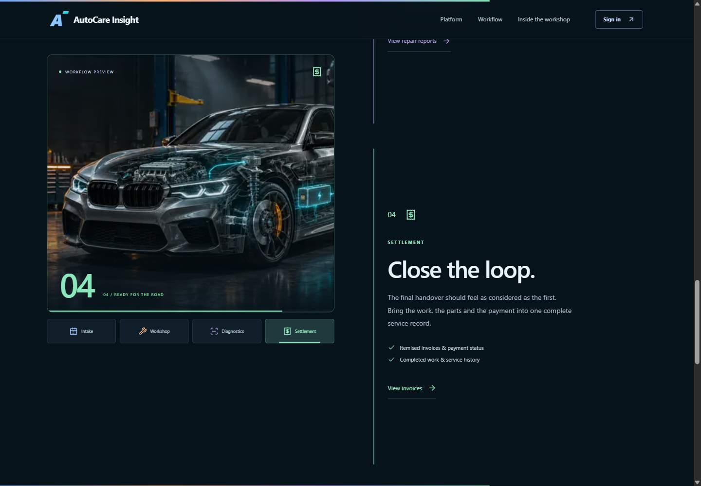
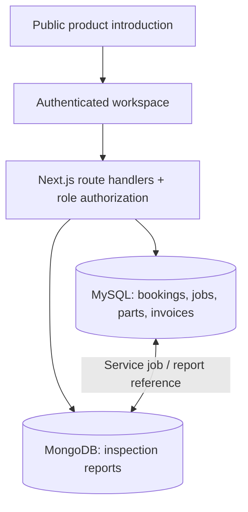

<p align="center">
  
</p>

<h1 align="center">AutoCare Insight</h1>
<p align="center"><strong>Vehicle service, connected.</strong><br />From the first handover to the final invoice.</p>
<p align="center">
  
  
  
  
</p>

AutoCare Insight brings appointments, workshop jobs, inspection findings, spare parts, and billing into a single role-based workspace. It is a working DBMS project built around a practical question: **how do you keep the whole service journey consistent when workshop data comes in different shapes?**

MySQL handles the transactional core. MongoDB stores variable inspection reports. The application connects the two through service jobs.

[Live website](https://autocare-insight.vercel.app) · [Application preview](#application-preview) · [Run locally](#run-locally) · [Free deployment](docs/DEPLOYMENT.md) · [Architecture](#architecture) · [Roadmap](#roadmap)

**Try the shared demo:** [autocare-insight.vercel.app](https://autocare-insight.vercel.app). Sign in as `rajesh@autocare.com` with `password123` to explore the service advisor workspace. Use sample data; visitors share this educational demonstration. It runs on cloud services with the developer's PC switched off. Free database hosting can introduce an idle startup delay.

## Application preview

The approved interface combines a cinematic workshop introduction, a service journey that advances as you scroll, and a consistent workspace with distinct module accents. Stage buttons, dialogs and navigation provide motion feedback and respect the device's reduced-motion setting.


<table>
  <tr>
    <td width="50%"><br /><strong>Workshop overview · dark</strong></td>
    <td width="50%"><br /><strong>Workshop overview · light</strong></td>
  </tr>
</table>



These are captures of the working interface. The public release has passed cloud sign-in, role checks, booking/rescheduling, photo upload, job assignment, inspection reports, stock deductions, concurrent invoice creation and recorded payments. [Deployment details](deploy/MANAGED_HOSTING.md).

## The service journey

| Stage | What you can do |
| --- | --- |
| Intake | Book appointments, record complaints, attach validated intake photos |
| Workshop | Assign mechanics, update job status, allocate replacement parts |
| Inspection | Record findings and DTCs, inspect fleet health, search diagnostic history |
| Settlement | Generate service invoices and record payments |
| Oversight | Manage customers, registered vehicles, stock and vehicle catalogue comparisons |
| Database lab | Explore a curated SQL query registry and MongoDB aggregation pipelines |

Accounts use server-verified passwords and HTTP-only session cookies. Administrators, service advisors, and mechanics receive different permissions. Roles are tied to the authenticated session; there is no public role-switching shortcut.

## Architecture



- **Next.js 15 / React 18 / TypeScript:** public introduction, operations workspace, and API routes.
- **MySQL 8:** relational integrity, transactions, stored procedures, views, and stock triggers.
- **MongoDB:** validated repair documents and aggregation pipelines.
- **Diagnostic search:** an in-process 64-dimensional encoder and cosine ranking. This is a lightweight similarity feature, not a trained predictive maintenance model.
- **Intake photos:** authenticated access, image decoding validation, and database storage. [Details](docs/INTAKE_PHOTOS.md).

## Run locally

Requirements: Node.js 22, MySQL 8, and MongoDB 8 running locally.

```powershell
npm ci
Copy-Item .env.example .env.local
# Edit .env.local with your local database credentials and a random JWT_SECRET.
npm run doctor
npm run setup:db
npm run dev
```

Open **http://localhost:3000**. The introduction is public; the workspace requires a seeded or existing account. Evaluation credentials and the walkthrough are in [VIVA_GUIDE.md](VIVA_GUIDE.md). The shared hosted demo intentionally uses sample accounts; use separate credentials and databases before handling private workshop records.

`setup:db` preserves existing tables and records. Do not run the historical `01_create_database.sql` against an existing database: it drops the database.

## Verification

```powershell
npm run typecheck
npm run lint
npm test
npm run build
```

The complete test runner includes live MySQL and MongoDB checks. Start both services and configure `.env.local` first. See [local verification](LOCAL_VERIFICATION.md) and [presentation evidence](docs/presentation/REVIEW.md) for the scope and limitations of the checks.

## Free deployment

The live application uses **Vercel Hobby**, **Enzonic Free native MySQL**, and **MongoDB Atlas M0**. Both databases are hosted independently of the developer's PC. MySQL stored routines and triggers remain intact. No paid plan, student credit or card-backed trial was used.

The tested production build is public at [autocare-insight.vercel.app](https://autocare-insight.vercel.app). Backup recovery, database migration, the cloud workshop workflow and anonymous public access were verified before release. Free tiers have capacity limits and can pause idle databases. [Managed hosting guide](deploy/MANAGED_HOSTING.md) · [Deployment and Docker guide](docs/DEPLOYMENT.md).

## Roadmap

These are proposed improvements, not completed features:

- [ ] Maintenance reminders derived from service dates and mileage, with explicit rules.
- [ ] Customer-facing service timeline with permission-scoped photo access.
- [ ] Per-bay workload planning and technician availability.
- [ ] Inventory reorder suggestions based on recorded usage.
- [ ] Measured diagnostic retrieval quality using a labelled evaluation set.
- [ ] Automated backups and restore drills before persistent public operation.

## Project map

| Location | Purpose |
| --- | --- |
| `src/app` | Pages and API routes |
| `src/components` | Layout, theme, forms, and intake photo UI |
| `src/lib/db` | Database access, query registry, and transactions |
| `database` | Relational schema, sample records, and advanced SQL |
| `scripts` | Local diagnostics, setup, and checks |
| `public/branding`, `public/images` | Original banner and real application screenshots |
| `compose.yaml`, `deploy` | Full-stack container deployment |
| `tests` | Authentication, validation, integration, and database checks |

[Project report](docs/PROJECT_REPORT.md) · [Data dictionary](database/DATA_DICTIONARY.md) · [ER model](database/ER_DIAGRAM.md) · [Advanced SQL](database/advanced/README.md) · [Viva guide](VIVA_GUIDE.md)

Developed for the DBMS Experiential Learning Level 3 project at PES University. Presentation structure inspired by [SakuraMind](https://github.com/ignite-2005/SakuraMind): branded introduction, actual application previews, clear architecture, and honest deployment limitations.
